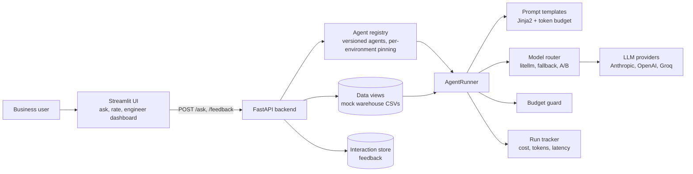

# Agent Orchestration Platform (AAOP)

A platform for deploying, versioning, routing and monitoring **LLM agents**. Business users ask questions in plain English; versioned agents answer from business data; engineers keep control over every agent, every version and every dollar spent.


## The problems it addresses

- How do you change a prompt without breaking live users? **Versioned agents.**
- How do you know a new version is better? **Golden-dataset evals and A/B routing.**
- How do you stop a retry loop from burning money? **A hard per-hour budget guard.**
- How do you switch from one model provider to another? **A model-agnostic router with fallback.**

## Architecture



A request picks an agent and version, the API injects the matching data view, the runner renders the prompt, routes it to a model, enforces the budget, and records the run.

## What is in the repository

| Area | Where | What it does |
|---|---|---|
| Core engine | `aaop/core/` | registry, version handling, routing and A/B router, prompt template engine, agent runner and state machine, budget guard, run tracker |
| Agents | `aaop/agents/` | 7 versioned agents (below), each with `agent.yaml`, prompts and a changelog |
| API and UI | `aaop/api/`, `aaop/ui/` | FastAPI backend (`/ask`, `/feedback`, `/health`) and Streamlit apps per environment |
| Evals | `aaop/evals/`, `aaop/tools/testing/` | golden test cases for 6 agents and an eval runner |
| Config | `aaop/configs/` | models, environments (dev, staging, prod), alerts, registry |
| Tests | `aaop/tests/unit/` | unit tests for versioning, budget guard, registry, router |
| CI | `.github/workflows/` | GitHub Actions: lint, type-check and test; agent validation; registry guard; changelog and release-note checks |

### Agents

| Agent | Purpose |
|---|---|
| `finance-finance-summary` | budget vs. actuals, flags overruns (two versions) |
| `sales-sales-pipeline` | deals, quota attainment |
| `hr-hr-headcount` | headcount and attrition |
| `marketing-marketing-campaigns` | campaign performance |
| `ops-ops-incidents` | incident response metrics |
| `supply-chain-supply-chain-inventory` | stock and supplier delivery |
| `legal-qa` | contract analysis with structured JSON output (hand-written reference agent) |

Most agents are generated from a view schema (`aaop/tools/generate_agent.py`). The data behind them is **synthetic sample data** in `aaop/data/mock/` that stands in for warehouse views. Person-name columns hold neutral placeholders such as `Employee_01`.

## Quickstart

```bash
cd aaop
cp .env.example .env            # add at least one provider API key
pip install -r requirements.txt -r requirements-dev.txt

python run_agent.py             # end-to-end run of the legal-qa reference agent
uvicorn api.app:app --reload    # backend
streamlit run ui/app.py         # UI
pytest                          # unit tests
```

The CLI entry point is `python -m aaop run <agent> <version> --query '...'`. See `ARCHITECTURE.md` for the full data flow and `CONTRIBUTING.md` for how to add an agent.

## Tech stack

`litellm`, `anthropic`, `openai`, `langgraph`, `langchain-core`, `jinja2`, `tiktoken`, `pydantic` v2, `fastapi`, `uvicorn`, `streamlit`, `click`, `rich`, `langsmith`, `pytest`, `ruff`, `mypy`. Optional: Snowflake connector for real warehouse views.

## Limitations

- The repository has **no published benchmark or results table**; the eval datasets exist, but no scores are recorded here.
- Warehouse access is mocked with CSV files. The Snowflake connector path is configured through environment variables but is not exercised by the sample data.
- Dependencies in `requirements.txt` use `>=` ranges, not pinned versions.
- Only the core engine has unit tests (4 test files). The API, UI and tools are not covered.
- `PLAN_V2.md` and `EXTERNAL_REPO_RESEARCH.md` are working notes from development, kept for context.

## License

[MIT](LICENSE)
